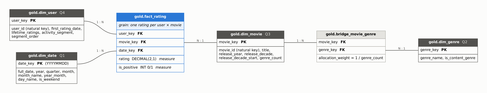

# MovieLens 25M Lakehouse — CMPS 360 Assignment 1

A reproducible Bronze → Silver → Gold pipeline built on **DuckLake** (DuckDB's open lakehouse format:
Parquet data files + a DuckDB catalog), answering four analytical questions about 25 years of movie ratings.

**Author:** Faisal Bu-shawareb · CMPS 360 L01 · Fall 2026

---

## Repository layout

```
├── README.md
├── requirements.txt
├── lakehouse.py                 shared paths, DuckLake connection, chart style
├── 01_bronze_ingestion.ipynb    source profile, simulated batches, raw load + load log
├── 02_silver_transform.ipynb    typing, validation, quarantine, quality report
├── 03_gold_star_schema.ipynb    fact + 4 dimensions + genre bridge, integrity checks
├── 04_analysis.ipynb            Q1–Q4: SQL on Gold, result tables, charts, interpretation
├── docs/
│   ├── star_schema.png          star-schema diagram
│   └── star_schema.dot          diagram source (Graphviz)
├── figures/                     charts written by 04_analysis.ipynb
├── data/                        (git-ignored) raw download + landing zone
└── lakehouse/                   (git-ignored) DuckLake catalog + Parquet files
```

## Setup and execution

Requires Python 3.10+ and ~3 GB free disk (raw CSVs ≈ 1.2 GB, landing copies ≈ 0.7 GB, lakehouse Parquet < 1 GB).

```bash
python -m venv .venv
source .venv/bin/activate            # Windows: .venv\Scripts\activate
pip install -r requirements.txt
```

**Get the data** (not committed — it is ~260 MB zipped). Either:

* download the zip manually from <https://www.kaggle.com/datasets/garymk/movielens-25m-dataset> and unzip it into `data/raw/`, or
* with the Kaggle CLI: `kaggle datasets download garymk/movielens-25m-dataset -p data/raw --unzip`

The notebooks search `data/raw/` recursively, so `data/raw/ratings.csv` and `data/raw/ml-25m/ratings.csv` both work.

**Run the notebooks in order**, from the repository root, each one top to bottom:

1. `01_bronze_ingestion.ipynb`
2. `02_silver_transform.ipynb`
3. `03_gold_star_schema.ipynb`
4. `04_analysis.ipynb`

or headless: `jupyter nbconvert --to notebook --execute --inplace 0*.ipynb`

All paths are relative to the repository root. Each notebook closes its lakehouse connection in its last cell
because DuckLake's catalog can only be attached by one process at a time — if a notebook stops halfway, restart
its kernel before running the next one. The first run downloads DuckDB's `ducklake` extension (needs internet once).

Re-running is safe: Bronze skips files already loaded, and Silver/Gold are rebuilt deterministically.
To start completely fresh, delete the `lakehouse/` folder (and `data/landing/` to regenerate the batch files).

---

## Task 1 — Source, grain and data dictionary

| Item | Value |
|---|---|
| Dataset | **MovieLens 25M** (`ml-25m`) |
| Source organisation | GroupLens Research, University of Minnesota (Kaggle mirror) |
| Direct URL | <https://www.kaggle.com/datasets/garymk/movielens-25m-dataset> (original: <https://grouplens.org/datasets/movielens/25m/>) |
| Access date | 14 October 2026 |
| Files | 6 CSV files (+ a README): `ratings.csv`, `movies.csv`, `tags.csv`, `links.csv`, `genome-scores.csv`, `genome-tags.csv` |
| Format | UTF-8 CSV, comma-separated, header row, quoted titles |
| Files used | `ratings.csv` (25,000,095 rows × 4 columns) and `movies.csv` (62,423 rows × 3 columns) |
| Coverage | 162,541 users rating movies between 9 January 1995 and 21 November 2019 |

Row and column counts for **every** file are recomputed from the download in `01_bronze_ingestion.ipynb`
(section 1, *Source profile*) — that output is the authoritative figure.

**Why it is interesting.** It is 25 years of real people rating real films, at a scale (25M rows) where the
pipeline design actually matters. It lets us ask how rating behaviour changed over time, which genres
audiences reward, whether older films enjoy a "classics" advantage, and how much a small group of very active
users shapes the whole picture — all questions a recommender or streaming team would care about.

### Source grain

* **`ratings.csv`:** one row = **one user's star rating of one movie**, with the moment it was given.
  MovieLens keeps only a user's latest rating of a movie.
* **`movies.csv`:** one row = **one movie** in the catalogue.

### Candidate keys

* `ratings.csv`: **(`userId`, `movieId`)** — a user has at most one current rating per movie.
  Verified as unique in Silver (`02_silver_transform.ipynb`, quality report).
* `movies.csv`: **`movieId`**.

### Data dictionary (columns used)

| File | Column | Source type | Silver type | Unit / domain | Meaning |
|---|---|---|---|---|---|
| ratings | `userId` | text | `user_id INTEGER` | anonymised id | the rater; consistent across files |
| ratings | `movieId` | text | `movie_id INTEGER` | id | the rated movie (FK to movies) |
| ratings | `rating` | text | `rating DECIMAL(2,1)` | stars, 0.5–5.0 in 0.5 steps | the rating given |
| ratings | `timestamp` | text | `rated_at TIMESTAMP`, `rating_date DATE` | seconds since 1970-01-01 UTC | when the rating was given |
| movies | `movieId` | text | `movie_id INTEGER` | id | the movie |
| movies | `title` | text | `title`, `title_clean VARCHAR`, `release_year INTEGER` | e.g. `Toy Story (1995)` | title with release year in parentheses (year entered manually, may be missing) |
| movies | `genres` | text | `genres VARCHAR` → `silver.movie_genres(genre)` | pipe-separated list, or `(no genres listed)` | genres of the movie (many per movie) |

### The four questions

| # | Question | Dimension | Type |
|---|---|---|---|
| Q1 | How did the **number of ratings** and the **average rating** change **year by year** from 1995 to 2019? | date | aggregate (count, average) over time |
| Q2 | Which **genres** receive the **highest and lowest average ratings** (genres with ≥ 10,000 ratings)? | genre | **ordered ranking** |
| Q3 | Are films from **older release decades** rated **higher** than recent films? | movie (release decade) | **comparison** |
| Q4 | How do **casual, regular, heavy and power users** differ in how much of the data they supply and how generously they rate? | user (activity segment) | **comparison** + share of total |

Together they use four dimensions (date, genre, movie, user) and only descriptive aggregation — no
prediction, clustering or causal claims.

---

## Task 2 — Ingestion strategy

| Decision | Choice | Justification |
|---|---|---|
| **Full vs incremental** | **Full first, then incremental** for ratings; **full snapshot every time** for movies | Ratings are an append-mostly event log with a reliable timestamp, so after one full load only newer rows need to move. `movies.csv` is small (~62k rows) and has no change timestamp — a catalogue entry can be corrected without trace — so reloading the whole snapshot is cheaper and safer than detecting changes. |
| **Watermark** | `ratings.timestamp` (Unix seconds) | The high-water mark is `max(timestamp)` of all successful ratings loads, stored in `bronze.load_log`. The next delivery should only contain rows newer than it. Rows at or below it (late arrivals / re-ratings) are still kept in Bronze and resolved in Silver by the key rule "latest rating per user × movie wins". |
| **Batch vs streaming** | **Batch** | Ratings are individually events, and a live MovieLens site could stream them (e.g. a message queue). But our source is a published file snapshot, and the questions are yearly/aggregate — nothing needs second-level freshness. Streaming would add infrastructure cost without changing any answer. |
| **Push vs pull** | **Pull** | GroupLens/Kaggle publish files; they do not call our system. Our job initiates the download (Kaggle API) on our schedule, decides when to retry, and controls the landing zone. |
| **Frequency** | **On demand / monthly check** | GroupLens publishes stable benchmark snapshots rarely, so a monthly pull that checks for a new release is enough. If connected to the live MovieLens platform, a **daily** incremental batch would suit yearly/genre-level questions. |

**Demonstrated incremental load.** `01_bronze_ingestion.ipynb` splits `ratings.csv` on the watermark into
`ratings_1995_2014.csv` (load 1, initial full) and `ratings_2015_2019.csv` (load 2, incremental), and logs the
watermark before and after each load.

**Recovery and rerun plan.**

* *Idempotent loads* — `bronze.load_log` records each file (name + size) with status; a file already loaded
  successfully is skipped, so rerunning never duplicates data.
* *Atomic loads* — each file's insert and its log row are one transaction. On any error (e.g. schema drift: a
  missing column) the load rolls back, a `FAILED` log row is written, and the file is retried next run.
* *Atomic landing writes* — batch files are written as `.part` then renamed, so a crash never leaves a
  half-written file that looks complete.
* *Count reconciliation* — input rows counted from the file must equal rows inserted, otherwise the load fails.
* *Deterministic downstream* — Silver and Gold are rebuilt from Bronze in transactions, so after fixing a
  problem, re-running notebooks 02–04 reproduces the same results. DuckLake snapshots also allow time travel
  to the state before a bad load.

---

## Pipeline summary

| Layer | Tables | Key points |
|---|---|---|
| **Bronze** | `ratings_raw`, `movies_raw`, `load_log` | all columns kept as raw text; `source_name`, `source_file`, `load_id`, `ingested_at` on every row; input vs loaded count per file per load |
| **Silver** | `movies`, `movie_genres`, `ratings`, `*_quarantine`, `quality_report` | types cast; release year parsed from title; genres split; 5 rating rules (R1–R5) and 4 movie rules (M1–M4); rejected rows quarantined with reason and lineage; reconciliation `Bronze = Silver + quarantine` asserted |
| **Gold** | `fact_rating`, `dim_date`, `dim_movie`, `dim_genre`, `dim_user`, `bridge_movie_genre` | star schema at grain *one rating per user × movie*; surrogate keys; PK uniqueness and FK integrity checked and asserted |

### Star schema



Each dimension exists for a question: `dim_date` → Q1, `dim_genre` (through the bridge) → Q2,
`dim_movie` → Q3, `dim_user` → Q4. The genre bridge is needed because a movie has several genres; it keeps
the fact table at one row per rating instead of duplicating ratings per genre.

---

## Task 7 — Reflection

My most important design decision was the grain of the fact table: one row per user × movie rating. Genres
pulled the other way — a movie has several, and putting genre on the fact would have multiplied 25 million
rows several times over and silently inflated every count in Q1, Q3 and Q4. Keeping the fact at rating grain
and resolving genres through a bridge table meant only Q2 deals with the many-to-many relationship, and does
so explicitly.

The main data-quality challenge was that useful attributes were packed into text. The release year exists
only inside the title, e.g. `(1995)`, sometimes as a range and sometimes missing, and genres are a
pipe-separated string with a `(no genres listed)` placeholder. I parsed the year with an anchored pattern and
kept movies without a year (setting it to NULL) rather than quarantining them, because rejecting a movie
would orphan its ratings and distort Q1, Q2 and Q4.

Cleaning increased trust because nothing disappears silently: every Bronze row ends up either in Silver or in
quarantine with a reason, and the notebook asserts that the counts reconcile, that the (user, movie) key is
unique, and that every fact row joins to every dimension.

One limitation is that MovieLens users are self-selected film enthusiasts, so averages describe this
community, not audiences in general; the first and last years are also partial.

If the dataset were refreshed regularly, I would replace the full Silver and Gold rebuilds with incremental
MERGEs driven by the watermark, so each refresh processes only the new batch instead of all 25 million rows.

---

## Known limitations

* **Partial years:** 1995 (from 9 Jan, very few ratings) and 2019 (to 21 Nov) are incomplete; Q1's evidence
  summary uses complete years only.
* **Release year** comes from the title and was entered manually by MovieLens; a small number of movies have
  none and appear as `Unknown` in Q3.
* **Dates are UTC.** A rating near midnight may fall on a different local calendar day.
* **Genre averages count a rating once per genre** of its movie, so genre totals exceed the total number of
  ratings (weights are stored in the bridge for allocated totals if needed).
* **User segments are type-1:** recalculated from each user's full history on every rebuild, not tracked over time.
* **Silver and Gold are full rebuilds** — simple and deterministic, but they reprocess all rows on each run.
* **No enforced constraints:** DuckLake does not enforce PRIMARY/FOREIGN KEYs, so they are checked by queries
  in notebooks 02 and 03 instead.
* The sample is not representative of all moviegoers (see reflection).

## Acknowledgements and academic integrity

* Data: F. Maxwell Harper and Joseph A. Konstan. 2015. *The MovieLens Datasets: History and Context.*
  ACM Transactions on Interactive Intelligent Systems 5(4): 19:1–19:19. https://doi.org/10.1145/2827872
* Tools: DuckDB and its DuckLake extension, pandas, matplotlib, Graphviz (diagram).
* **AI assistance:** I used Claude (Anthropic) to help design the pipeline and draft the notebook code, the
  diagram and this README. I ran every notebook end to end on the full dataset, checked the outputs, and
  wrote/verified the interpretations against the actual results. I am responsible for, and understand, all
  submitted work.
